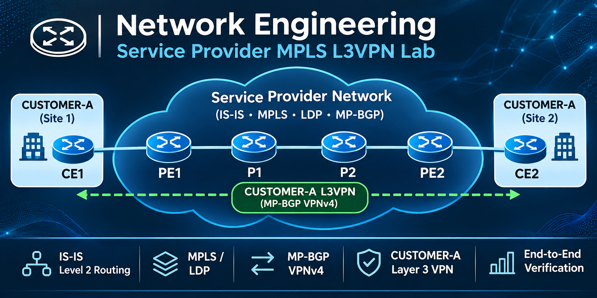
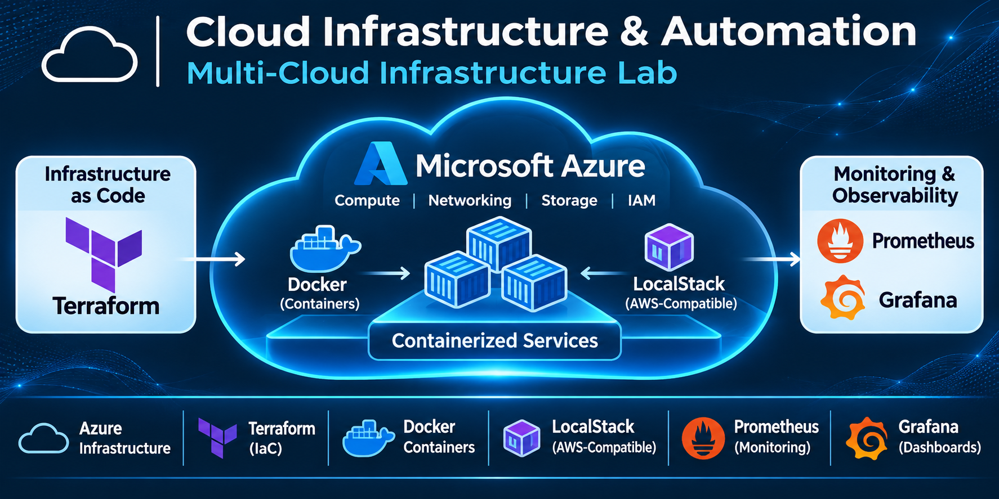
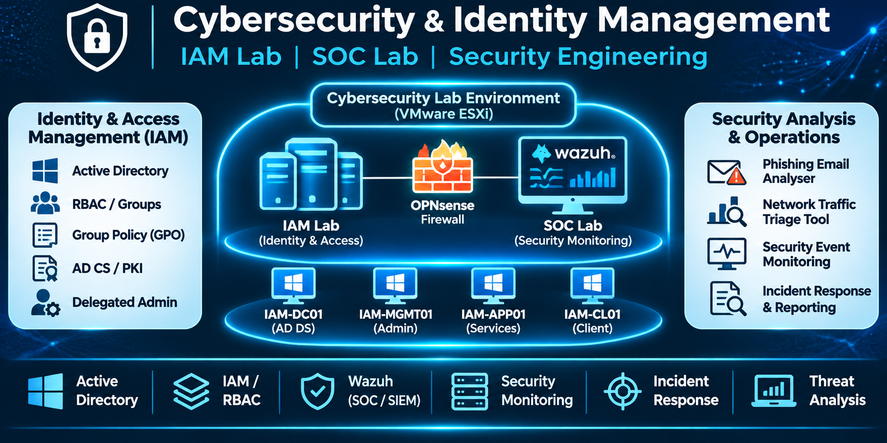

# Network & Cloud Infrastructure Engineer

### Telecom Operations | Network Automation | Cybersecurity & IAM

Welcome to my engineering portfolio!

I'm an experienced Network and Telecommunications Engineering professional with a background in enterprise infrastructure, service operations, network design, troubleshooting, and technical leadership.

My current focus is expanding my expertise in **Cloud Infrastructure, Infrastructure as Code, Identity and Access Management (IAM), and Cybersecurity Operations** through hands-on engineering projects.

This portfolio demonstrates practical implementations, network architectures, technical documentation, troubleshooting procedures, and verified testing results.

---

## Featured Engineering Projects

<table>
  <tr>
    <td width="33%" align="center">
      
       
      <b>Network Engineering</b>
    </td>
    <td width="33%" align="center">
      
       
      <b>Cloud Infrastructure</b>
    </td>
    <td width="33%" align="center">
      
       
      <b>Cybersecurity & IAM</b>
    </td>
  </tr>
</table>

### 🌐 Network Engineering

**[Service Provider MPLS L3VPN Lab](https://github.com/jr6793108/Network-Engineering-Portfolio/tree/main/Project-01-Service-Provider-Network)**

Designed, implemented, and validated a six-router service-provider network using Containerlab, FRRouting, IS-IS, MPLS/LDP, and MP-BGP VPNv4.

**Engineering accomplishments**
- Established provider-core routing and MPLS label distribution.
- Implemented CUSTOMER-A Layer 3 VPN connectivity between two customer sites.
- Verified bidirectional customer connectivity with zero packet loss during recorded testing.
- Documented recovery procedures, troubleshooting findings, and validation evidence.

**Value demonstrated:** Service-provider network engineering, routing troubleshooting, MPLS VPN operations, and infrastructure recovery.

---

### ☁️ Cloud Infrastructure & Automation

**[Multi-Cloud Infrastructure Lab](https://github.com/jr6793108/Multi-Cloud-Lab)**

Built hands-on infrastructure environments demonstrating Infrastructure as Code, containerized services, cloud networking, and operational monitoring.

**Engineering accomplishments**
- Provisioned reproducible infrastructure using Terraform.
- Implemented AWS-compatible storage with LocalStack and MySQL services.
- Developed Docker-based application and monitoring environments.
- Integrated Prometheus and Grafana for infrastructure and application observability.
- Documented deployment verification, troubleshooting, and recovery procedures.

**Value demonstrated:** Cloud infrastructure engineering, automation, Linux operations, containerization, and monitoring.

---

### 🔐 Cybersecurity & Identity Management

**[Cybersecurity Engineering Portfolio](https://github.com/jr6793108/Cybersecurity)**

Developed practical cybersecurity environments and tools focused on identity security, threat detection, security monitoring, and incident response.

**Engineering accomplishments**
- Built a VMware ESXi-based Active Directory environment with OPNsense network segmentation.
- Implemented IAM controls including RBAC, delegated administration, Group Policy, and security assessments.
- Deployed Wazuh security monitoring and investigated Windows authentication events.
- Documented security investigations, incident response activities, and supporting evidence.
- Developed browser-based phishing email analysis and network traffic triage tools.

**Value demonstrated:** IAM administration, security operations, security monitoring, incident investigation, and network security.

---

## Technical Skills

**Networking:** TCP/IP, BGP, IS-IS, OSPF, MPLS, LDP, VPN, routing and switching

**Cloud & Infrastructure:** Microsoft Azure, Terraform, Docker, VMware ESXi, Linux

**Cybersecurity:** Active Directory, IAM, RBAC, Group Policy, Wazuh, SIEM, security monitoring

**Operations:** Troubleshooting, network monitoring, documentation, technical leadership, service operations

---

## Professional Focus

I am interested in opportunities involving:

- Senior Network Engineering
- Cloud Infrastructure Engineering
- Network and Cloud Operations
- Infrastructure Automation
- Network Security and Identity Infrastructure

My goal is to combine extensive infrastructure engineering experience with modern cloud and cybersecurity practices.

---

## Connect With Me

- **GitHub:** [jr6793108](https://github.com/jr6793108)
- **LinkedIn:** [Linkdeln](https://www.linkedin.com/in/jerry-ruiz-9491839/)

---

*Engineering through practical implementation, verification, troubleshooting, and continuous learning.*
